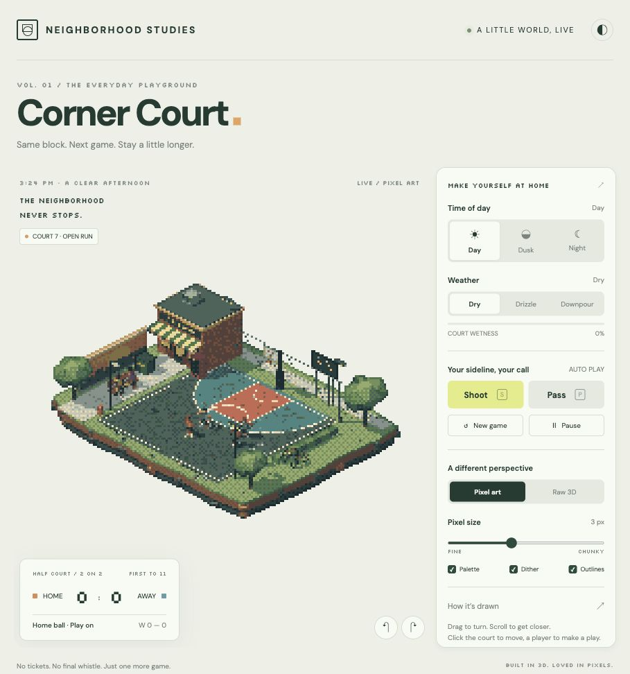

# Corner Court

A living, pixel-art street basketball diorama built in a single HTML file with Three.js r160.

**[Play Corner Court](https://xiaokhkh.github.io/corner-court/)**



## On the block

- Procedural floating city block with a painted half court, corner shop, mural, trees, bicycles, spectators, and pigeons.
- Autonomous 2v2 streetball: check ball, clear the arc, make-it-take-it, 1s and 2s, first to 11, and persistent win totals within the session.
- Articulated players with two-bone inverse kinematics, passes, jumpers, layups, dunks, defensive contests, and rebounds.
- Substepped ball physics with rim, backboard, ground, and boundary collisions.
- Orthographic isometric camera with quarter-turn rotation and zoom.
- Low-resolution rendering, depth outlines, a 54-color OKLab palette, optional Bayer dithering, and whole-pixel upscaling.
- Full-resolution, antialiased Raw 3D mode.
- Day, dusk, and night lighting; drizzle and downpour; accumulating wetness and mirrored puddle reflections.
- Responsive English interface with light and dark themes.

## Controls

| Action | Control |
| --- | --- |
| Shoot | **S**, Shoot button, or click the ball handler |
| Pass | **P**, Pass button, or click the teammate |
| Move handler | Click a spot on the court |
| Pause / resume | **Space** or Pause button |
| Rotate | Drag sideways, **← / →**, or turn buttons |
| Zoom | Mouse wheel or pinch |

The players continue automatically when you are not directing a play.

## Run locally

No build step or package installation is needed. Serve this directory with any static web server:

```sh
python3 -m http.server 8000
```

Then visit `http://localhost:8000`.

All scene geometry, textures, styles, and game logic live in `index.html`. Three.js r160 loads through an import map from jsDelivr; Silkscreen and DM Sans load from Google Fonts, so an internet connection is required for those dependencies.

## Verification

Desktop and mobile browser checks covered rendering controls, weather, reflections, pause, and manual shooting. A 20-minute headless simulation exercised scoring, possession changes, jumpers, layups, dunks, blocks, steals, rebounds, out-of-bounds resets, and game completion. Rule assertions checked arc scoring, make-it-take-it, clearing after turnovers, and retention of win totals when starting a new game.
